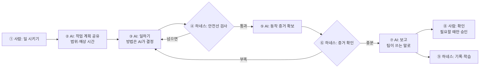

# VMC 하네스

**AI 코딩 에이전트(Claude Code·Codex)에 붙여 쓰는 안전장치이자 기억 장치입니다.**
사람은 평소처럼 일을 시키기만 합니다. 하네스는 AI가 해서는 안 되는 일을 막고, 팀이 바로잡아 준 것을 기억해 두고, 붙여 둔 장치 중 효과가 없는 것은 스스로 걷어냅니다.

---

## 하네스가 뭔가요?

운전에 비유하면 이렇습니다.

- **AI 에이전트**는 운전을 잘하는 기사입니다. 길도 잘 찾고 운전 실력도 좋습니다.
- **하네스**는 차에 달린 장치들입니다. 차선 이탈 경고, 긴급 제동, 블랙박스, 주행 기록 같은 것들이요.

좋은 차는 기사에게 "핸들을 몇 도 돌려라"라고 지시하지 않습니다. 대신 **절대 넘으면 안 되는 선**은 장치로 막고, **무슨 일이 있었는지**는 기록으로 남깁니다. VMC 하네스도 같습니다. AI에게 일하는 순서를 정해 주지 않고, 지켜야 할 선과 확인할 수 있는 기록만 줍니다.

> 요즘 AI 모델은 일을 잘합니다. 그래서 "1단계 설계, 2단계 구현, 3단계 검토…" 같은 절차를 붙이면 오히려 느려지고, 더 좋은 방법을 쓰지 못하게 됩니다. 장치가 불편해지면 사람은 결국 하네스를 끄고 그냥 쓰게 됩니다. **하네스의 목표는 불편 없이 쓸모 있는 최소한의 장치**입니다.

---

## 왜 필요한가요?

AI에게 일을 맡기다 보면 이런 일이 생깁니다.

| 흔히 겪는 일 | 하네스가 하는 일 |
|---|---|
| "이건 하지 마"라고 여러 번 말해도 다음 대화에서 또 한다 | 말(지시문) 대신 **장치로 막는다** — 처음부터 할 수 없게 |
| AI가 "완료했습니다"라고 해도 믿을 수 없어 사람이 다시 확인한다 | **실제로 동작한 증거**가 있어야 완료로 인정한다 |
| 같은 설명을 대화마다 반복한다 | 한 번 바로잡은 것을 **팀 전체가 기억**하게 한다 |
| 확인 요청이 너무 많거나 무슨 말인지 알기 어렵다 | 꼭 필요한 것만, **3분 안에 판단할 수 있는 형태**로 묻는다 |
| 안전장치를 많이 붙였더니 오히려 느려졌다 | 붙인 장치마다 **효과를 재서, 효과 없으면 스스로 뺀다** |

---

## 누가 무엇을 하나요?

| | 하는 일 |
|---|---|
| **사람** | 평소처럼 일을 시킨다. 꼭 필요할 때만 승인·거절한다. 결과를 확인한다 |
| **AI 에이전트** | 일을 어떤 순서·방법으로 할지 스스로 정하고 수행한다 |
| **하네스** | 넘으면 안 되는 선을 막는다. 증거를 확인한다. 기록하고 배운다. 효과 없는 장치는 걷어낸다 |

사람에게 승인을 받는 경우는 딱 세 가지입니다.

1. **되돌릴 수 없는 일** — 운영 서버 배포, 운영 데이터베이스 변경처럼 실수하면 되돌리기 어려운 것
2. **안전선을 넓히는 일** — 결재·인증처럼 보호해 둔 영역을 고치거나, 보호 목록을 줄이는 것
3. **사람만 아는 정보·결정** — 처음 한 번 넣는 계정 정보, 업무 판단이 필요한 것

그 밖의 일(장치 관리, 업데이트, 효과 판정 등)은 사람이 신경 쓰지 않아도 됩니다.

---

## 일 하나는 이렇게 흘러갑니다



- ④·⑥에서 걸리면 하네스는 **무엇이 빠졌는지만** 알려 줍니다. 어떻게 고칠지는 AI가 정합니다.
- ⑨에서 남긴 기록(걸린 시간, 사람이 끼어든 횟수 등)은 장치를 유지할지 뺄지 판단하는 근거가 됩니다.

---

## 다섯 가지 설계 원칙

### 1. 말보다 장치로

규칙을 지키게 하는 방법에는 네 단계가 있고, **위에 있을수록 확실합니다.**

| 순서 | 방법 | 예시 |
|---|---|---|
| 1 | **구조** — 처음부터 잘못할 수 없게 | 데이터베이스를 읽기 전용 계정으로만 연결 → 쓰기 자체가 불가능 |
| 2 | **게이트** — 잘못하면 자동으로 막힘 | 테스트가 깨지면 작업을 끝낼 수 없음 |
| 3 | **규칙** — AI가 매번 읽는 지시문 | 이 팀에서 "DB"는 개발 데이터베이스를 뜻함 |
| 4 | **카드** — 상황마다 답이 다른 판단 | 큰 버그는 단계를 나눠 고친다 |

위에서 막을 수 있으면 아래에 적지 않습니다. 지시문은 가장 지켜지지 않고 관리하기도 어렵기 때문입니다.

### 2. 절차는 정하지 않는다

AI에게는 **목표, 지켜야 할 선, 참고할 자료, 결과물 형식**만 줍니다. 순서와 방법은 AI가 정합니다. 그래야 모델이 좋아질수록 하네스도 함께 좋아집니다.

### 3. 잘못 막지 않는다

멀쩡한 걸 막는 장치는 사람을 귀찮게 하고 신뢰를 깎습니다. 그래서 하네스는 **놓치는 일이 있더라도, 막은 것은 전부 진짜 문제**가 되도록 만듭니다. 하네스가 배우는 근거도 사람의 분명한 행동(되돌리기, 거절, "그냥 진행")뿐입니다. AI가 짐작한 것으로는 장치를 만들지 않습니다.

### 4. 붙인 장치는 재고, 효과 없으면 뺀다

새로 붙인 장치는 시험 기간(최소 10회 작동, 최대 21일)을 거칩니다. 판정은 AI가 아니라 **스크립트가 숫자로** 합니다. 효과가 없으면 원래대로 되돌리고, 그 사실을 기록합니다.

### 5. 사람의 확인은 꼭 필요할 때만

위의 "승인받는 세 가지"를 빼면 묻지 않습니다. 알림은 작업 중에 끼어들지 않고 옆 패널에 쌓입니다.

---

## 기억은 층으로 나눠서

모든 지식을 한 폴더에 섞어 두면 무엇이 중요한지 알 수 없고 관리하기도 어렵습니다. 하네스는 **아래층일수록 엄격하게, 위층일수록 자유롭게** 다룹니다.

| 층 | 무엇이 들어 있나 | 누가 바꾸나 |
|---|---|---|
| **브레인** (맨 위) | 여러 프로젝트에 두루 쓰는 판단 카드 — 팀의 일하는 스타일 | AI가 자유롭게 추가. 지우거나 위로 올릴 때는 근거 필요 |
| **실측 기록** | 작업 기록, 걸린 시간, 장치별 판정 (숫자·상태만) | 하네스만 기록. 추가만 가능하고 아무도 고칠 수 없음 |
| **프로젝트 장치** | 이 프로젝트용 게이트·규칙·테스트 시나리오·보호 영역 | 하네스가 자동으로 넣고 빼며, 모두 기록하고 되돌릴 수 있음 |
| **엔진** (맨 아래) | 하네스 자체의 원칙과 판정 기준 | **AI는 읽기만.** VMC가 검증한 버전만 배포 |

맨 아래 엔진을 AI가 고칠 수 없게 한 이유는 간단합니다. 자기 안전장치와 채점 기준을 스스로 고칠 수 있으면 안전장치가 아니기 때문입니다.

---

## 주요 기능

- **처음 진단** — 설치하면 지난 AI 대화 기록과 코드를 읽고 "잘하고 있는 것 · 개선할 것"을 담은 진단 리포트(HTML·PDF)를 만듭니다. 원하는 제안만 골라 "1, 3번 넣어줘"라고 하면 됩니다
- **데이터베이스 안전장치** — 조회는 읽기 전용 도구로만, 직접 접속은 실행 전에 차단. 쓰기는 SQL 파일로 만들고 적용은 사람이 합니다
- **보호 영역** — 결재·인증처럼 중요한 코드는 고치기 전에 사람 승인
- **완료 증거** — 화면·API·데이터 동작이 바뀌었으면, 하네스 도구가 만든 실제 증거가 있어야 작업이 끝납니다. "확인했습니다"라는 말은 증거가 아닙니다
- **테스트 자동 반복** — 사람이 필요 없는 실패는 AI가 스스로 고치고 다시 시험. 사람에게는 "사람이 필요한 것"만 한 번에 모아서
- **알아보기 쉬운 보고** — 팀원들이 실제로 쓰는 말로 보고하고, 승인 요청은 4줄(무엇을 결정하나 · 권장과 이유 · 되돌릴 수 있나)로
- **팀이 함께 배우기** — "앞으로 이건 막아"라고 하면 그 말 그대로 장치가 됩니다. 저장소를 통해 팀원 모두에게 적용됩니다
- **야간 정리** — 사람이 일하지 않는 시간에, 동작은 그대로 두고 코드만 정리합니다. 다음 날 첫 대화에서 알려 드립니다

---

## 시작하기

> 라이선스 키 없이 설치·사용할 수 있습니다. 비밀번호는 대화창이 아니라 **터미널에만** 입력합니다(대화 기록에 남지 않도록).

```bash
# 1. 설치 (PC당 한 번)
# macOS
curl -fsSL https://api.vibemafiaclub.com/harness/install.py | python3 -
# Windows (설치 후 터미널을 껐다 켜야 명령이 인식됩니다)
irm https://api.vibemafiaclub.com/harness/install.py | python -

# 2. 프로젝트에 설치 + 첫 진단 (프로젝트마다 한 번, 프로젝트 폴더에서)
vmc-harness init

# 3. 개발 데이터베이스 연결 (필요한 프로젝트만, 읽기 전용 계정)
vmc-harness db-credential
```

이후에는 **Claude Code를 평소처럼 쓰면 됩니다.** 따로 외울 명령은 없습니다. Claude Code를 쓰면 옆 패널에 승인 대기·알림·이번 주 배운 것·팀 대시보드가 보입니다(Codex에서도 기능은 동작합니다).

| 가끔 쓰는 명령 | 하는 일 |
|---|---|
| `vmc-harness start-loop` | 야간 정리를 지금 시작 |
| `vmc-harness link-brain <git 주소>` | 판단 카드를 팀 저장소에 연결해 공유 |
| `vmc-harness why <파일 또는 작업>` | 그 결과에 어떤 규칙·장치가 영향을 줬는지 보기 |
| `vmc-harness revert` | 하네스가 한 변경 되돌리기 |
| `vmc-harness activate` | VMC에서 받은 라이선스 키 등록(선택 — 여러 PC의 야간 정리 겹침 방지·오프라인 번들) |
| `vmc-harness remove` | 이 프로젝트에서 하네스 제거(기록은 기본으로 남김) |

---

## 데이터는 어디에 있나요?

| 위치 | 무엇 | 누가 보나 |
|---|---|---|
| 각자의 PC | AI 대화 원본, 상세 기록 | 본인 |
| 팀 저장소 `.harness/` | 숫자·상태·장치·규칙 (원문·코드 조각·비밀번호 없음) | 팀 |
| VMC 서버 | 버전 정보(라이선스 키를 등록했으면 그 키)뿐 | VMC |

**작업 데이터는 PC와 팀 저장소 밖으로 나가지 않습니다.**

---

## 자주 묻는 질문

**쓰던 방식을 바꿔야 하나요?**
아니요. Claude Code를 평소처럼 쓰면 됩니다. 기존 지시문(AGENTS.md 등)은 그대로 두고, 하네스 블록만 덧붙입니다.

**작업이 느려지지 않나요?**
늘어나는 건 작업 시작 때의 예상 시간 계산 정도이고, 나머지는 작업과 따로 돌아갑니다. 하네스가 늘린 시간도 측정해서, 정해 둔 한도를 넘으면 비싼 편의 기능부터 스스로 끕니다. 안전장치는 끄지 않습니다.

**하네스가 잘못 막으면요?**
"그냥 진행"을 고르면 됩니다. 그 선택이 곧 "이 장치는 잘못 막았다"는 기록이 되고, 쌓이면 그 장치는 풀립니다.

**개발이 아닌 업무(조사·기획 등)에도 쓸 수 있나요?**
지금의 VMC 하네스는 코드 개발용입니다. 다만 위의 **다섯 가지 원칙과 층 구조**는 어떤 업무에도 그대로 적용됩니다. 순정 AI로 일을 먼저 해 보고, 사람이 끼어든 지점만 구조 → 게이트 → 규칙 → 카드 순서로 메우고, 붙인 것은 재서 효과 없으면 빼면 됩니다.

---

문의: 최수민 · VIBE MAFIA CLUB 대표 · sumin@vibemafiaclub.com
